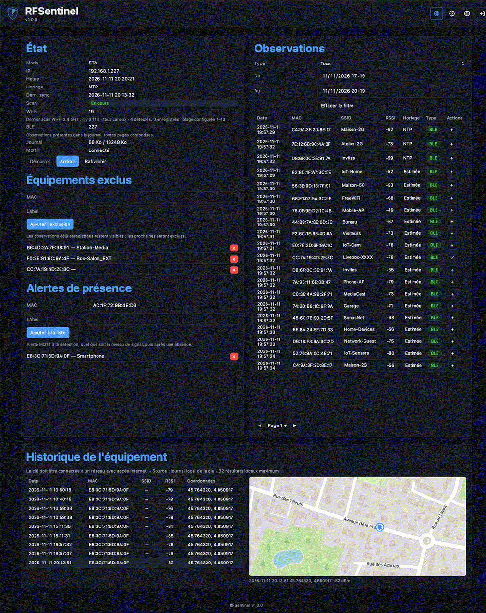
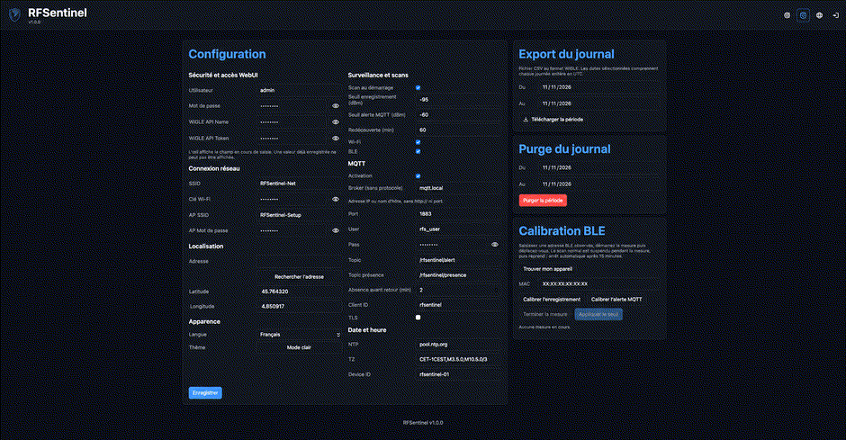
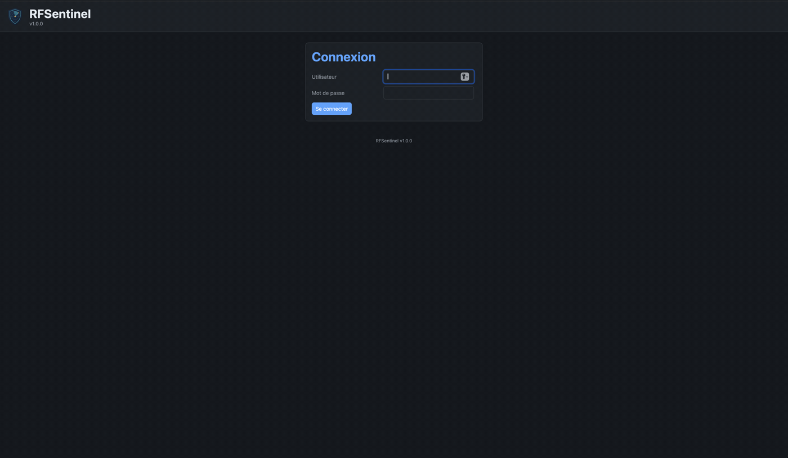
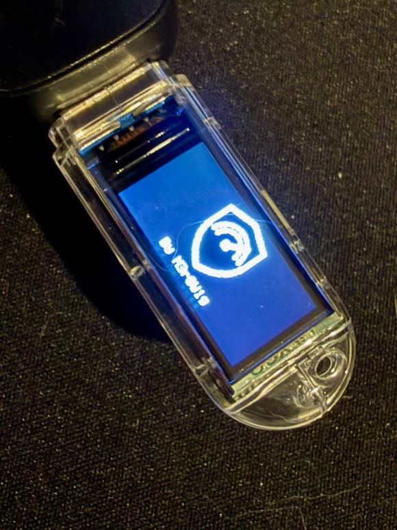
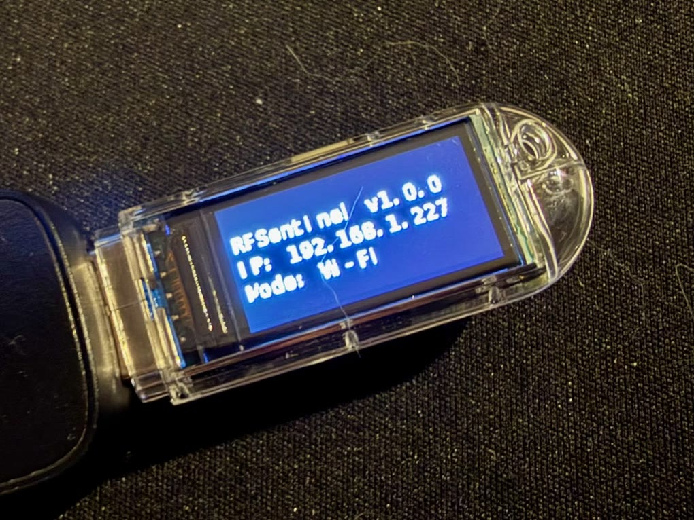
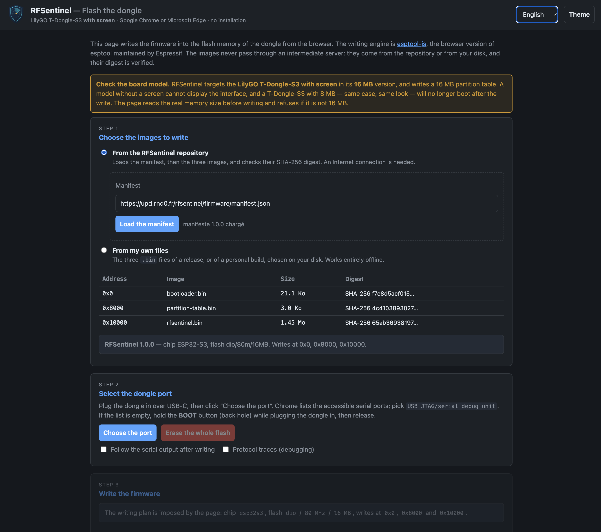

<p align="center">
  
</p>

<h1 align="center">RFSentinel</h1>

<p align="center">
  <strong>Standalone, fully passive radio probe on an ESP32-S3 dongle</strong><br>
  Wi-Fi 2.4 GHz + Bluetooth Low Energy · connects to nothing, intercepts nothing<br>
  <em>Version 1.0.0</em>
</p>

<p align="center">
  <a href="#license"></a>
  
  
  
  
</p>

<p align="center"><strong>English</strong> · <a href="docs/fr/README.md">Français</a></p>

RFSentinel listens to the radio environment around us and makes it readable.
Plugged into a USB port, it picks up **freely broadcast** frames — Wi-Fi beacons
and Bluetooth LE advertisements — timestamps them, records them in its own flash,
and serves them over a built-in web interface. It joins no network, decrypts
nothing, intercepts no communication: it observes, it records, it displays.

The starting point is a place with a problem: a house, a shop, a business.
RFSentinel keeps the record of what was within radio range while the facts happened.
The recording threshold (`min_rssi`, -95 dBm by default) sets that range, wide or
narrow depending on the room, the shop or the car park you want to cover, and the
dongle writes down everything that passes: Wi-Fi and Bluetooth LE addresses, possible
SSIDs, signal level, timestamp. Afterwards you filter the journal over a time range
and get the list of the devices that were there between such hour and such hour on
that day.

That list serves to relocate. Every address seen by RFSentinel can be queried in
WiGLE's public tables from the device itself: the history of known positions appears
in the interface, in chronological order and on the map. A phone, a watch or an
object that was transmitting during the incident is thus matched against the places
where it has already been picked up. The approach holds up best for Wi-Fi and for
stable Bluetooth addresses: phones advertise temporary BLE addresses that nothing
lets you follow over time or find back on WiGLE, hence the filtering described below.

The dongle runs in two ways, depending on the place. Connected to your Wi-Fi network
— the option to prefer — it takes the time from the NTP server, contacts WiGLE and
publishes its alerts over MQTT. With no network in range, it opens its own access
point and all that is left is to set the time from the interface: the board has no
internal clock that keeps time, but the time set by hand is saved periodically and
found again after a restart. Passive scanning and journal writes never stop: with or
without a network, everything that passes within range is recorded.

Alerting comes second. RFSentinel publishes a newly detected device over MQTT
(`/rfsentinel/alert`) and the appearance or return of a watched device
(`/rfsentinel/presence`, 32 addresses at most with their labels), so that Home
Assistant or any controller can react to a message. The heart of the product stays
the journal: knowing afterwards what was there, at what distance and at what time.


## Overview

The observations page, in full:

<p align="center"></p>

| Configuration | Login |
|---|---|
|  |  |

On the board, in its transparent case — on the left the boot screen, which stays
lit for one minute before switching off and releasing the memory used by scanning:

| Boot | Status screen |
|---|---|
|  |  |

## Features

**Capture**

- **Fully passive** 2.4 GHz Wi-Fi scanning (`WIFI_SCAN_TYPE_PASSIVE`): no probe
  request is sent, no association is made. A 4 s cycle, up to 40 networks per cycle.
- Bluetooth LE scanning by advertisements (NimBLE, `filter_duplicates` enabled):
  10 s every 20 s, never establishing a connection.
- Two independent RSSI thresholds: one for **recording**, one for **MQTT alerting**,
  so distant transmitters stay in the journal without triggering alerts.
- De-duplication in RAM with configurable rediscovery: a device becomes "new" again
  after N minutes of absence.
- Persistent MAC **exclusion list** (blacklist) to ignore the devices next door for good.
- Three **BLE filtering** modes (`All`, `Stable` by default, `Public only`) keep
  temporary addresses out of the journal.

**Logging**

- **WiGLE-compatible CSV** format (`WigleWifi-1.6`): the files produced re-import
  as-is into WiGLE.net or any tool that reads that format.
- **LittleFS** storage on a 13 MB internal partition, one file per day, 32 KB
  segments, a ceiling of 32 files, and rotation that only ever touches the oldest files.
- Writes are journaled: a power cut does not corrupt what has already been recorded,
  and nothing is erased on restart.
- **CSV export** downloadable by date range, straight from the WebUI.
- **Purge by date range**: you choose the period to delete, nothing goes blindly.

**Built-in web interface**

- Single-file application served by the dongle itself: no critical external
  dependency, nothing to install on the client machine.
- **Bilingual French / English** and **light or dark theme**, both remembered locally
  in the browser.
- Live state: network mode, IP, clock quality, Wi-Fi and BLE counters, journal usage,
  MQTT state.
+ Paginated observations (14 per page), filtered by type and date range, sortable.
- **Per-device history**: every appearance of a MAC address, with direct selection
  on the map.
- **Map** rendered in a `<canvas>` with OpenStreetMap tiles and **address →
  coordinates** geocoding through the French national address database.
- **Built-in WiGLE lookup**: for a given MAC, what WiGLE already knows — date, RSSI,
  name, type, position — shown separately from local observations.
- **Field BLE calibration**: enter the address of a device you are carrying, measure
  while walking away, and the tool proposes suitable recording and alert thresholds.

**Standalone operation and integration**

- Works **without a network**: if the configured Wi-Fi is unreachable, the dongle
  falls back to a rescue access point and the interface stays available, scans included.
- NTP clock with a persisted time reference and **estimated timestamps** offline.
  Time quality is always displayed — `NTP_SYNCED`, `ESTIMATED` or `UNKNOWN` —
  an uncertain time is never presented as exact.
- **Manual WiGLE upload only**, with confirmation, progress tracking and a detailed
  result. No automatic sending, ever.
- **MQTT alerts**: broker, port, credentials, topic, client ID and TLS configurable,
  automatic reconnection, QoS 1. Scanning and logging continue even when no broker
  is reachable.
- **Presence alerts**: declare MAC addresses to watch, each with a label. They trigger
  an MQTT alert on detection regardless of signal level, then a return alert after an
  absence (120 s by default). The topic and the absence window are set separately, and
  monitoring stays active even if the device is excluded from the journal.
- **ST7735 160×80 screen**: boot screen with logo, version, mode and IP, then a status
  screen. The display switches off **after one minute** and releases the 25.6 KB of DMA
  RAM reserved for rendering. That is what makes WiGLE queries possible: wait for the
  screen to go dark before consulting a device's WiGLE history.

### Bluetooth LE: MAC address rotation and filtering

Unlike many Wi-Fi devices, Bluetooth Low Energy (BLE) devices — smartphones,
connected watches, earbuds in particular — can use **temporary MAC addresses** that
change regularly to protect their users' privacy.

This mechanism, provided for by the Bluetooth specification, makes it hard to
identify the same device over time. It also fills the journal with entries that can
never reliably be found back on platforms such as WiGLE.

**To limit the problem, RFSentinel offers three BLE filtering modes:**

- **All:** records every address detected, temporary ones included.
- **Stable (default):** keeps only public addresses (*Public*) and static random
  addresses (*Random Static*).
- **Public only:** keeps public MAC addresses exclusively.

Temporary **RPA and NRPA** addresses left out of the journal are still counted in the
BLE activity statistics.

The filtering cuts down useless records, saves storage space and favours addresses
that may persist, and are therefore more useful for identification or for a later
search on WiGLE.

**Limit:** a Random Static address is not necessarily permanent, and no address kept
in the journal is guaranteed to be referenced in WiGLE. Filtering improves how useful
the data is without guaranteeing that devices get identified.

## Hardware

| Item | Value |
|---|---|
| Board | **LilyGO T-Dongle S3 with display** (ESP32-S3) |
| Flash | **16 MB** internal — no SD card |
| PSRAM | none, everything is sized for internal RAM |
| Display | ST7735, driven at **160×80** landscape, 1 bpp rendering |
| Radio | Wi-Fi 2.4 GHz (passive) + Bluetooth LE (observer) |
| GPS | none — position is entered manually or from an address lookup |
| Power | USB-C, with built-in USB-Serial-JTAG |

Display pins, as wired on the T-Dongle S3:

```
CLK 5 · MOSI 3 · DC 2 · RST 1 · CS 4 · backlight 38
```

The firmware drives that ST7735 panel and ships a 16 MB partition table, so the only
board it runs on is the **T-Dongle S3 with display, in its 16 MB version**. Variants
sold without a screen, and the 8 MB ones, share the same case and the same look but
are not supported: one has no panel to drive, the other cannot hold a 16 MB
partition table and will not boot.

## Getting started

1. Plug in the dongle. The screen shows the logo, version, mode and IP.
2. With no network configured (or after a connection failure), the dongle
   broadcasts the access point **`RFSentinel-Setup`** (password `012345678`).
3. Join it, then open **http://192.168.4.1**.
4. Log in with `admin` / `admin`. Changing the password is **forced** on first login.
5. Set up the Wi-Fi network, position, thresholds, WiGLE, MQTT, language and
   timezone. Everything is written to NVS and survives reboots.

On the local network, the interface is also available at
**http://rfsentinel.local** when the client and network support mDNS. Under
**Configuration → Network**, the **Network name** field sets both the DHCP
hostname and the mDNS name. Enter 1–32 lowercase letters, digits or hyphens,
starting and ending with a letter or digit; omit `.local`. Save and restart the
dongle to apply the change. Give each dongle a different name on the same network.
If mDNS is unavailable, use the IP shown on the screen or by the router; the
setup access point remains available at **http://192.168.4.1**.

## Building

The project targets **ESP-IDF v5.3.2**, chip `esp32s3`. Dependencies are pinned
(`idf_component.yml` + `dependencies.lock`, notably `joltwallet/littlefs ==1.23.1`),
so a build is reproducible.

```bash
idf.py set-target esp32s3
idf.py reconfigure
idf.py build
```

The build configuration is fixed in `sdkconfig.defaults`: 16 MB flash, custom
partition table, NimBLE in observer mode, mbedTLS with the full CA bundle for
HTTPS, embedded HTTP server.

### Partition table

| Partition | Type | Offset | Size |
|---|---|---|---|
| `nvs` | data/nvs | `0x9000` | 24 KB |
| `phy_init` | data/phy | `0xf000` | 4 KB |
| `factory` | app | `0x10000` | 3 MB |
| `storage` | data/littlefs | `0x310000` | 13 MB (`0xCF0000`) |

## Firmware binaries

The three images for the current version are in the [`bin/`](bin) folder, next to a
`SHA256SUMS` file, so you can flash without compiling:

| Address | File | Size | SHA-256 |
|---|---|---|---|
| `0x0` | `bootloader.bin` | 21,648 B | `f7e8d5acf0157d246f2594c415728fe98a15e294ab8a0c1cbfe4a61841fe5297` |
| `0x8000` | `partition-table.bin` | 3,072 B | `4c41038930270e3e0073c60762b35cd693ad237238c335617ba9a03a0cfdf913` |
| `0x10000` | `rfsentinel.bin` | 1,482,464 B | `65ec22d5a8daac6222d0a90345e6e737490440ceeb8c32f8a4fcf8571cc17fa2` |

Verify them before writing:

```bash
cd bin && shasum -a 256 -c SHA256SUMS     # Linux and macOS
```

On Windows, PowerShell prints the same hash with `Get-FileHash`.

`webtool/firmware/` holds the same three images plus the manifest used by the
browser flasher. `tools/package_webtool_firmware.py` refreshes both folders in one
pass and cross-checks the hashes, so `bin/` and `webtool/firmware/` never drift apart.

## Flashing with esptool

Flash parameters are the same everywhere: `--flash-mode dio --flash-freq 80m
--flash-size 16MB`, at addresses `0x0`, `0x8000` and `0x10000`.

> **Check the exact board model before writing to flash.** A 16 MB partition table
> on an 8 MB board leaves the device unusable. The LilyGO T-Dongle S3 targeted here
> has 16 MB, but smaller variants exist with the same case and the same look.

### Install the tool

**Linux** (Debian, Ubuntu and derivatives — PEP 668 blocks a bare `pip install`,
so use a virtual environment):

```bash
sudo apt install python3-venv
python3 -m venv ~/.venvs/esptool
~/.venvs/esptool/bin/pip install esptool
~/.venvs/esptool/bin/esptool version
```

Allow the serial port, then log out and back in:

```bash
sudo usermod -aG dialout $USER
```

**macOS** (Homebrew):

```bash
brew install esptool
esptool version
```

**Windows**: install Python from python.org, then in PowerShell:

```powershell
py -m pip install esptool
py -m esptool version
```

The dongle uses the ESP32-S3 built-in USB-Serial-JTAG, so no external converter
driver is needed and Windows 10/11 usually installs it through Windows Update. Device
Manager should show **USB Serial Device (COMx)** under Ports (COM & LPT). If the port
is missing, install the Espressif drivers with the Espressif Installation Manager
(`eim install-drivers`). If Zadig is suggested, leave interface 0 on the USB Serial
(CDC) driver: putting WinUSB on interface 0 makes the COM port disappear. WinUSB
belongs on the JTAG interface only, and esptool does not need it to flash.

If you already have ESP-IDF, it ships its own esptool, so no extra install is needed.
From the project root, `idf.py -p PORT flash` writes the same three images at
the same addresses, reading them from `build/` instead of `bin/`.

### Port names

| System | Typical port |
|---|---|
| Linux | `/dev/ttyACM0` (sometimes `/dev/ttyUSB0` through a converter) |
| macOS | `/dev/tty.usbmodem…` — check with `ls /dev/tty.usb*` |
| Windows | `COM3`, `COM4`… — check in Device Manager |

### Write the three images

esptool 5 uses dashes. This is the form to type:

```bash
# Linux
esptool --chip esp32s3 -p /dev/ttyACM0 -b 460800 --before default-reset --after hard-reset \
  write-flash --flash-mode dio --flash-freq 80m --flash-size 16MB \
  0x0 bin/bootloader.bin 0x8000 bin/partition-table.bin 0x10000 bin/rfsentinel.bin
```

```bash
# macOS — run from the repository root, port taken from ls /dev/tty.usb*
esptool --chip esp32s3 -p /dev/tty.usbmodem31401 -b 460800 \
  --before default-reset --after hard-reset \
  write-flash --flash-mode dio --flash-freq 80m --flash-size 16MB \
  0x0 bin/bootloader.bin 0x8000 bin/partition-table.bin 0x10000 bin/rfsentinel.bin
```

```powershell
# Windows — same command, backticks for line continuation
py -m esptool --chip esp32s3 -p COM3 -b 460800 --before default-reset --after hard-reset `
  write-flash --flash-mode dio --flash-freq 80m --flash-size 16MB `
  0x0 bin\bootloader.bin 0x8000 bin\partition-table.bin 0x10000 bin\rfsentinel.bin
```

If your esptool came from ESP-IDF 5.3 rather than a recent standalone install, it is
version 4.x and expects underscores: `write_flash`, `--flash_mode`, `--flash_freq`,
`--flash_size`, `--before default_reset`, `--after hard_reset`, and the program is
named `esptool.py`. Those spellings still work on esptool 5, which accepts them with a
deprecation warning, so the same old command keeps running after an upgrade.

If the port list is empty or the tool cannot connect, hold the BOOT button while
plugging the dongle in, then retry.

## Flashing from the browser

**The recommended way to flash a dongle is the online flasher:
<https://upd.rnd0.fr/rfsentinel/>.** It is the page from this repository, served
next to the images it writes, so there is nothing to install and nothing to
configure. Open the link in Chrome or Edge, choose the port, write. The images it
offers carry the hashes given in the table above.



The page itself is `webtool/index.html`. It drives the serial port through the Web
Serial API and relies on [esptool-js](https://github.com/espressif/esptool-js) 0.7.1,
loaded locally from `webtool/vendor/esptool-js/` — no CDN, no intermediate service.
Chrome and Edge are the only browsers that expose the serial port; Safari and
Firefox cannot open it at all. Every image has its SHA-256 verified before anything
is written.

The page is bilingual French / English: a selector sits in the header, the choice is
remembered in the browser, and the first visit takes the language of the browser.

Open the file directly (double-click) or serve it locally:

```bash
python3 -m http.server 8000     # then http://localhost:8000/webtool/
```

The page works over `file://`, over HTTPS and on `localhost`; elsewhere the browser
refuses access to the serial port.

1. Choose where the images come from: the repository (manifest plus three files, with
   SHA-256 verification) or three `.bin` files taken from your disk.
2. Plug in the dongle, click "Choose port", select `USB JTAG/serial debug unit`. If
   the list is empty, hold BOOT while plugging it in.
3. Confirm the actual memory size, then write. The page reads the chip and its
   capacity before any write and refuses a board that is not an ESP32-S3 with 16 MB.

The write plan is hard-coded in the page (`dio` / `80 MHz` / `16 MB`, at addresses
`0x0`, `0x8000` and `0x10000`), and a manifest cannot change it: that is the only
barrier against an 8 MB board. After writing, the MD5 fingerprint read back from flash
is compared with the one of the image that was sent.

The "From repository" mode reads the firmware from `webtool/firmware/`, which the
repository must contain. Regenerate it after every build:

```bash
idf.py build
python3 tools/package_webtool_firmware.py    # refreshes bin/ and webtool/firmware/
python3 tools/make_webtool_vendor.py         # only when the esptool-js version changes
```

The sizes and fingerprints in the two sections above describe the images in `bin/`.
The browser flasher verifies the fingerprint announced by the manifest it loads.

> Hosting matters more than it looks. The attachments of a GitHub release return no
> `Access-Control-Allow-Origin` header, so a page served from another site cannot read
> them. The raw files of a repository and a Pages site do return that header. The
> simplest setup stays the one used at `upd.rnd0.fr/rfsentinel/`: page, manifest and
> images come from the same host, so no cross-origin rule is involved.

## Web API

Every `/api/*` route requires an authenticated session, except `/api/login`. The
session is a `sid` cookie, `HttpOnly`, `SameSite=Strict`, valid for one hour, with a
30 s lockout after repeated failures.

| Method | Route | Purpose |
|---|---|---|
| GET | `/` | web interface (embedded HTML) |
| GET | `/logo/rfsentinel-logo.svg` | logo |
| GET | `/logo/rfsentinel-icon.svg` | icon |
| POST | `/api/login` | login (`{user, pass}`) → session cookie |
| POST | `/api/logout` | logout |
| GET | `/api/config` | read configuration, secrets masked |
| POST | `/api/config` | update (partial merge, validated server-side) |
| GET | `/api/scan/status` | mode, IP, time and quality, counters, journal, MQTT |
| POST | `/api/scan/start` | start scanning |
| POST | `/api/scan/stop` | stop scanning |
| GET | `/api/observations` | paginated list — `page`, `type`, `sort`, `dir`, `cursor`, `from`, `to` |
| GET | `/api/history` | appearances of a MAC (`mac`) |
| GET | `/api/presence` | watched devices, topic and absence window |
| POST | `/api/presence` | add or remove a watched device (`action`, `mac`, `label`) |
| GET | `/api/blacklist` | exclusion list |
| POST | `/api/blacklist/add` | add an exclusion (`{mac, label}`) |
| POST | `/api/blacklist/remove` | remove an exclusion (`{mac}`) |
| POST | `/api/wigle/upload` | trigger the manual upload to WiGLE |
| GET | `/api/wigle/upload/status` | upload progress and result |
| GET | `/api/wigle` | what WiGLE knows about a MAC (`mac`) |
| POST | `/api/purge` | purge by date range (`{from, to}`) |
| GET | `/api/purge/status` | purge progress |
| GET | `/api/calibration` | state of the running calibration |
| POST | `/api/calibration` | start, feed or finish a measurement |
| GET | `/api/calibration/find` | look for a nearby BLE device (`mac`) |
| GET | `/api/export` | CSV export of the journal (`from`, `to`) as an attachment |
| GET | `/api/time` | current time and timestamp quality |
| POST | `/api/time` | manual time setting |

## WiGLE

If a WiGLE lookup fails or takes too long, scanning can be paused temporarily from
the Scan page and restarted by hand; no observation and no presence alert is
captured while it is paused.

- Upload is **manual**: dedicated button, explicit confirmation, then intermediate
  status until the result. Never any automatic sending.
- CSV header: `WigleWifi-1.6,apssids=true,latlon=true,lockedToNetwork=false,cellBands=auto`.
- `lat` / `lon`: the coordinates configured in RFSentinel (the dongle has no GPS).
- Wi-Fi search (`network/search`) and Bluetooth search (`bluetooth/search`), with the
  matching `detail` endpoints for full records.
- **Basic** authentication over **HTTPS** (full CA bundle).
- The WiGLE API name and token never leave the device: not in API responses, not in
  logs, not in exports.

## MQTT

An alert is published for every new device above the MQTT threshold, QoS 1, no retain:

```json
{"device_id":"…","mac":"…","type":"WIFI","ssid":"…","rssi":-72,
 "ts":"2026-11-11 10:50:10","tsq":"NTP_SYNCED","lat":48.85660,"lon":2.35222}
```

`tsq` gives the timestamp quality — `NTP_SYNCED`, `ESTIMATED` or `UNKNOWN` — so a
consumer can set badly dated messages aside: in the last case `ts` is `"0"`.

Watched devices publish on their own topic (`/rfsentinel/presence` by default), never
on the alert topic:

```json
{"event":"presence","device_id":"…","mac":"…","type":"BLE","label":"…",
 "ssid":"…","rssi":-71,"ts":"2026-11-11 10:50:10","tsq":"NTP_SYNCED"}
```

`label` carries the label entered in the interface, which tells several watched devices
apart without knowing their MAC addresses.

### Connecting RFSentinel to Home Assistant

RFSentinel **publishes** its events to the MQTT broker named in its configuration.
Home Assistant, joined to the same broker through its MQTT integration, **listens** to
the topic it cares about, and its automation **reads the message and runs the actions
you configured**. Nothing special is installed on RFSentinel: it behaves like any other
MQTT client, and the scenarios are written in Home Assistant exactly as with any other
broker.

Two topics are available:

| Topic | Event |
|---|---|
| `/rfsentinel/alert` | new device detected |
| `/rfsentinel/presence` | a device on the watch list was detected, or came back |

Both names can be changed on the configuration page, and they cannot be the same.
Messages are JSON: an alert carries the device type, its MAC address, the SSID if any
and the RSSI; a presence message also carries the label given to the device in
RFSentinel, and shows `null` rather than 127 when the BLE signal is not measurable.

In Home Assistant, create an automation and pick **"When an MQTT message has been
received"** as the trigger. Enter the topic to listen to, for example
`/rfsentinel/alert`. Then add an action: a persistent notification, a push to a phone,
controlling a device. To reuse the message fields in a notification, a template such as:

```yaml
{{ trigger.payload_json.type }} detected — SSID: {{ trigger.payload_json.ssid or 'unknown' }} — MAC: {{ trigger.payload_json.mac }} — RSSI: {{ trigger.payload_json.rssi }} dBm
```

The template reads the fields of the JSON received at trigger time. Conditions can
filter by MAC address or by type before the action runs: switch on a light, have a
voice assistant speak, send an alert to a phone. Use one automation per topic if you
want to treat new devices and watched devices differently.

Presence alerts also react to absence: while a watched device has been away for
`absence_s` (120 s by default), its return triggers a new publication on the presence
topic.

## Privacy and security

- **Observation only**: no connection to the networks it detects, no decryption, no
  interaction with Bluetooth devices.
- **Secrets stored in NVS**, never read back in clear by the interface: the six
  sensitive fields (WebUI password, WiGLE API name and token, Wi-Fi key, access point
  password, MQTT password) show eight dots when a value is already saved. The eye icon
  reveals **what you are typing**, not the stored value.
- A field left **empty** keeps the saved value: a secret cannot be overwritten by
  accident.
- Authentication is mandatory, cookie `HttpOnly` + `SameSite=Strict`, lockout after
  repeated failures, `admin/admin` forced on first run with a required password change.
- The legal framework belongs to the user: RFSentinel only observes freely broadcast
  frames, but capturing radio data and what you do with it is regulated differently
  from one country to another.

## Repository layout

```
CMakeLists.txt          ESP-IDF project
partitions.csv          partition table (nvs, phy_init, factory, storage)
sdkconfig.defaults      pinned build configuration
idf_component.yml       dependencies (littlefs 1.23.1) · dependencies.lock lockfile
README.md               this page (English)
DOCUMENTATION.md        architecture, trade-offs, constants (English)
LICENSE                 CC BY-NC-SA 4.0
bin/                    firmware images of the current version + SHA256SUMS
docs/fr/                French README and documentation
main/
  main.c                startup, main loop
  version.h             RFS_VERSION "1.0.0"
  config.[ch]           NVS configuration, secrets, validation
  net.[ch]              STA + rescue AP, NTP, timestamp quality
  scanner.[ch]          passive Wi-Fi and BLE scans, thresholds, de-dup, calibration
  store.[ch]            LittleFS journal /rfs/observations, rotation, purge, export
  web.[ch]              HTTP server + JSON API
  ui/index.html         embedded web interface (FR/EN, light/dark)
  wigle.[ch]            WiGLE upload and lookup (API v2, HTTPS)
  auth.[ch]             WebUI sessions, anti brute-force
  mqtt.[ch]             MQTT alerts
  presence.[ch]         watched addresses, presence alerts
  display.[ch]          ST7735 screen: boot, status, auto-off
  oled_font.h           8×16 glyph table
  oled_logo.h           64×64 logo as a 1 bpp bitmap
  lcd/                  ST7735 driver
logo/                   SVG (embedded for the WebUI, source of the screen bitmap)
screen/                 screenshots used on this page
webtool/
  index.html              browser flasher (Chrome/Edge, Web Serial)
  vendor/esptool-js/      write engine, generated local copy
  firmware/               images and manifest served to the flasher
tools/make_webtool_vendor.py       bundle esptool-js as a classic script
tools/package_webtool_firmware.py  fills bin/ and webtool/firmware/
tools/generate_lcd_logo.py         SVG → 1 bpp bitmap for the screen
tests/                  host-side tests (logic, API, interface)
```

## Tests

Thirty-one standalone programs run on the development machine, with no ESP-IDF and
no board: twenty in Python, nine in JavaScript with Node, two in C. They cover the
logic that does not depend on hardware — journal and rotation, CSV export, calibration
and its thresholds, MQTT threshold and de-duplication, watched devices and presence
alerts, recounting, concurrent access, LittleFS iteration, WiGLE lookups under
simulated allocations, framebuffer lifetime when the screen switches off, and the
behaviours of the interface.

```bash
for t in tests/test_*.py; do python3 "$t"; done
for t in tests/test_*.js; do node "$t"; done

LFS=managed_components/joltwallet__littlefs/src/littlefs
cc -I"$LFS" tests/test_littlefs_iter_host.c "$LFS/lfs.c" "$LFS/lfs_util.c" \
   -o /tmp/lfs_iter && /tmp/lfs_iter

cc -Imain tests/test_ble_address.c -o /tmp/bleaddr && /tmp/bleaddr
```

The LittleFS test compiles against the library fetched by ESP-IDF, so `idf.py
reconfigure` has to have run at least once. The BLE address test only needs the
headers from `main/`. The other twenty-nine start as they are.

## Known limitations

- The ESP32-S3 has no battery-backed real-time clock: without power and without NTP,
  the time is only an estimate, and it is flagged as one.
- Wi-Fi and BLE share the same 2.4 GHz radio: the scans divide the radio time between
  them. The web interface stays available during scans.
- The 160×80 screen cannot display an SVG: the logo is converted off-target into a
  1 bpp bitmap by `tools/generate_lcd_logo.py`.
- A weakly received device may be missing from both the journal and WiGLE: absence from
  the list does not prove absence of a transmitter.
- Position depends on configuration: with no coordinates entered, observations are
  timestamped but not located.
- Phones and BLE objects advertise temporary addresses (RPA, NRPA) that are found
  neither from one session to the next, nor on WiGLE. Filtering keeps the stable
  addresses by default, without guaranteeing that they are permanent.

## License

**RFSentinel** is licensed under **[CC BY-NC-SA 4.0](LICENSE)** — attribution,
non-commercial, share-alike.

In practical terms: you may use it, study it, modify it and share it. Derived versions
and forks stay under the same licence, so they remain free and non-commercial as well.
**Any commercial use requires prior written agreement from the author.**

Two third-party components keep their own licence and are not covered by this one:
`joltwallet/littlefs` and `esptool-js` 0.7.1, both Apache-2.0. The esptool-js licence
text ships next to its bundle, in `webtool/vendor/esptool-js/LICENSE`.

## Acknowledgements

- [LilyGO](https://lilygo.cc/) for the T-Dongle S3.
- [esptool-js](https://github.com/espressif/esptool-js) for the write engine behind the
  browser flasher.
- [WiGLE.net](https://wigle.net/) for the crowdsourced mapping infrastructure.
- [joltwallet/littlefs](https://github.com/joltwallet/esp_littlefs) for the filesystem.
- [OpenStreetMap](https://www.openstreetmap.org/copyright) for the map tiles.
- The French national address database ([adresse.data.gouv.fr](https://adresse.data.gouv.fr/))
  for geocoding.

---

*RFSentinel v1.0.0 — built with ESP-IDF 5.3.2.*

