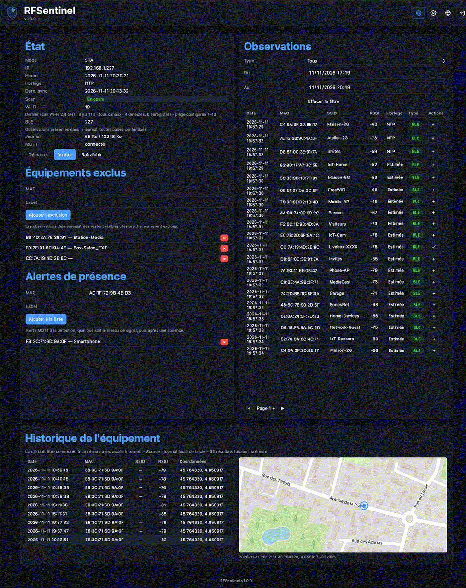
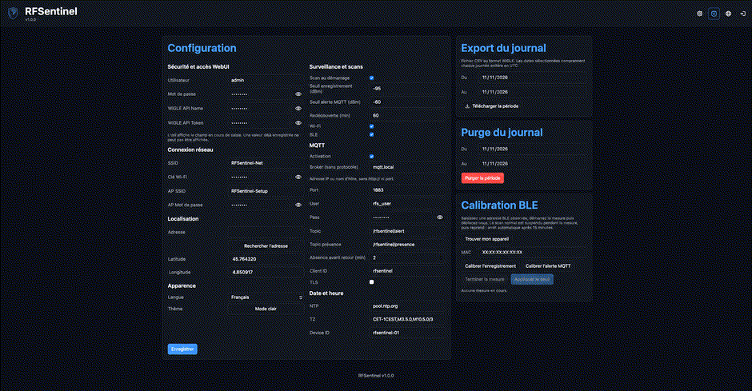
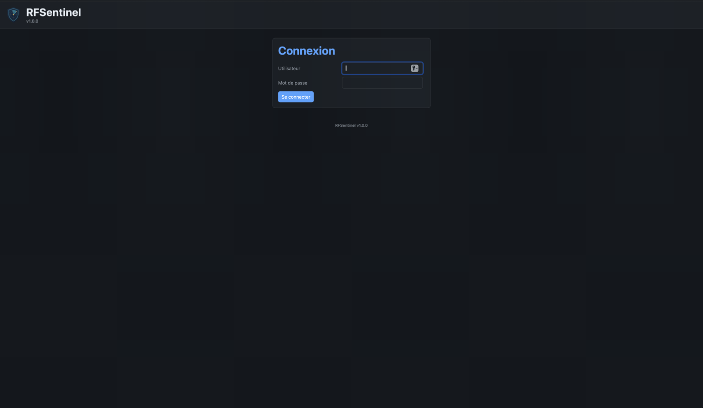
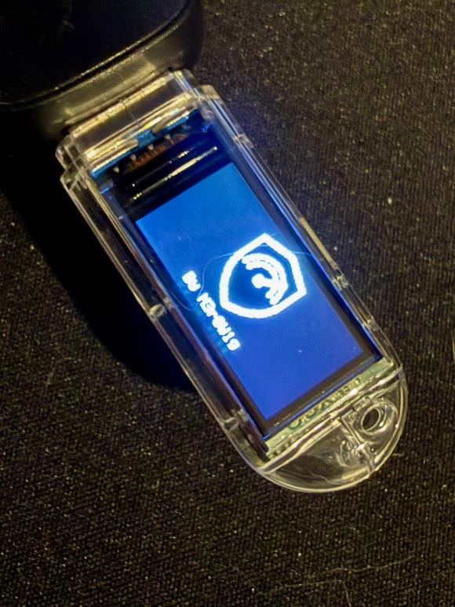
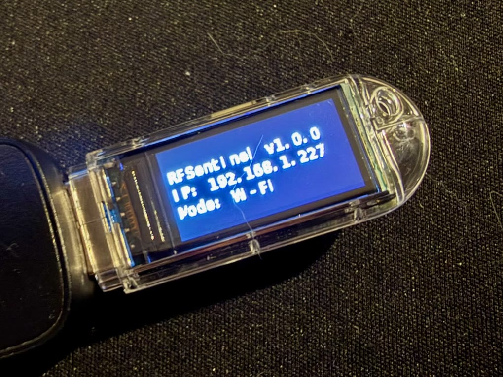

<p align="center">
  
</p>

<h1 align="center">RFSentinel</h1>

<p align="center">
  <strong>Sonde radio autonome et 100 % passive sur dongle ESP32-S3</strong><br>
  Wi-Fi 2.4 GHz + Bluetooth Low Energy · aucune connexion, aucune interception<br>
  <em>Version 1.0.0</em>
</p>

<p align="center">
  <a href="#licence"></a>
  
  
  
  
</p>

<p align="center"><strong>Français</strong> · <a href="../../README.md">English</a></p>

RFSentinel écoute l'environnement radio qui nous entoure et le rend lisible.
Branché sur un port USB, il capte les trames **librement diffusées** — les
beacons Wi-Fi et les advertisements Bluetooth LE — les horodate, les journalise
dans sa propre flash, et les expose sur une interface Web embarquée. Il ne se
connecte à aucun des réseaux qu'il enregistre, ne déchiffre rien, n'intercepte
aucune communication : il observe, il note, il affiche.

Le point de départ est un lieu qui a un problème : une maison, un magasin, une
entreprise. RFSentinel garde la trace de ce qui se trouvait à portée de radio
pendant les faits. Le seuil d'enregistrement (`min_rssi`, -95 dBm par défaut)
règle cette portée, large ou étroite selon la pièce, le magasin ou le parking que
l'on veut couvrir, et la clé écrit tout ce qui passe : adresses Wi-Fi et
Bluetooth LE, SSID éventuels, niveau du signal, horodatage. Plus tard, on filtre
le journal sur une plage d'heures et l'on obtient la liste des équipements qui
ont été là entre telle heure et telle heure ce jour-là.

Cette liste sert à relocaliser. Chaque adresse vue par RFSentinel peut être
interrogée dans les tables publiques de WiGLE depuis l'appareil : l'historique
des positions connues s'affiche dans l'interface, en ordre chronologique et sur
la carte. On rapproche ainsi un téléphone, une montre ou un objet qui émettait
pendant l'incident des endroits où il a déjà été capté. La démarche vaut
surtout pour le Wi-Fi et pour les adresses Bluetooth stables : les téléphones
diffusent des adresses BLE temporaires que rien ne permet de suivre dans le
temps ni de retrouver sur WiGLE, d'où le filtrage décrit plus bas.

Deux façons de faire tourner la clé, selon l'endroit. Connectée à votre réseau
Wi-Fi — c'est la solution à privilégier —, elle reprend l'heure sur le serveur
NTP, contacte WiGLE et publie ses alertes sur MQTT. Sans réseau à portée, elle
ouvre son propre point d'accès et il ne reste qu'à lui régler l'heure depuis
l'interface : la carte n'a pas d'horloge interne qui la conserve, mais l'heure
réglée à la main est enregistrée périodiquement et retrouvée après un
redémarrage. Le scan passif et l'écriture du journal, eux, ne s'arrêtent pas :
avec ou sans réseau, tout ce qui passe à portée est noté.

Alerter vient en second. RFSentinel publie sur MQTT un nouvel équipement détecté
(`/rfsentinel/alert`) et l'apparition ou le retour d'un équipement suivi
(`/rfsentinel/presence`, 32 adresses au maximum avec leur libellé), de sorte que
Home Assistant ou n'importe quel automate peut réagir à un message. Le cœur du
produit reste le journal : savoir après coup ce qui était là, à quelle distance
et à quelle heure.

## Aperçu

La page des observations, en entier :

<p align="center"></p>

| Configuration | Connexion |
|---|---|
|  |  |

Sur la carte, avec son boîtier transparent — à gauche l'écran de démarrage, qui
reste allumé une minute avant de s'éteindre et de libérer la mémoire utilisée par
le scan :

| Démarrage | Écran d'état |
|---|---|
|  |  |

## Fonctionnalités

**Capture**

- Scan Wi-Fi 2.4 GHz **entièrement passif** (`WIFI_SCAN_TYPE_PASSIVE`) : aucun
  probe request émis, aucune association. Cycle de 4 s, jusqu'à 40 réseaux par cycle.
- Scan Bluetooth LE par advertisements (NimBLE, `filter_duplicates` activé) :
  10 s toutes les 20 s, sans jamais établir de connexion.
- Deux seuils RSSI indépendants : le seuil d'**enregistrement** et le seuil
  d'**alerte MQTT**, pour garder les émetteurs lointains sans être alerté par eux.
- Déduplication en RAM avec redécouverte paramétrable : un équipement redevient
  « nouveau » après N minutes d'absence.
- Liste d'**exclusions** (blacklist) par MAC, persistée, pour ignorer définitivement
  les équipements « à porte ».
- Trois modes de **filtrage BLE** (`Tous`, `Stable` par défaut, `Public
  uniquement`) pour écarter les adresses temporaires du journal.

**Journalisation**

- Format **CSV compatible WiGLE** (`WigleWifi-1.6`) : les fichiers produits se
  réimportent tels quels sur WiGLE.net ou dans tout outil lisant ce format.
- Stockage **LittleFS** sur une partition interne de 13 Mo, un fichier par jour,
  segments de 32 Ko, plafond de 32 fichiers et rotation qui ne touche jamais
  qu'aux fichiers les plus anciens.
- Les écritures sont journalisées : une coupure d'alimentation ne corrompt pas
  ce qui a déjà été enregistré, et rien n'est effacé au redémarrage.
- **Export CSV** téléchargeable par plage de dates, directement depuis la WebUI.
- **Purge par plage de dates** : on choisit la période à supprimer, rien ne part
  à l'aveugle.

**Interface Web embarquée**

- Application mono-fichier servie par le dongle lui-même : aucune dépendance
  externe critique, aucune installation sur le poste client.
- **Bilingue français / anglais** et **thème clair ou sombre**, tous deux
  mémorisés localement dans le navigateur.
- État en direct : mode réseau, IP, qualité de l'horloge, compteurs Wi-Fi et BLE,
  occupation du journal, état MQTT.
+ Observations paginées (14 par page), filtrées par type et par plage de dates,
  triables.
- **Historique par équipement** : toutes les apparitions d'une adresse MAC, avec
  sélection directe sur la carte.
- **Carte** rendue en `<canvas>` avec tuiles OpenStreetMap et géocodage
  **adresse → coordonnées** via la base adresse nationale française (FR).
- Consultation **WiGLE intégrée** : pour un MAC donné, ce que WiGLE sait déjà —
  date, RSSI, nom, type, position — affiché à part des observations locales.
- **Calibration BLE sur le terrain** : on saisit l'adresse d'un appareil que l'on
  porte, on mesure en l'éloignant, et l'outil propose le seuil d'enregistrement et
  le seuil d'alerte adaptés.

**Autonomie et intégration**

- Fonctionne **sans réseau** : si le Wi-Fi configuré est injoignable, le dongle
  bascule en point d'accès de secours et l'interface reste accessible, scans compris.
- Horloge NTP avec référence temporelle persistée et **horodatage estimé** hors
  ligne. La qualité du temps est toujours affichée : `NTP_SYNCED`, `ESTIMATED`
  ou `UNKNOWN` — jamais une heure incertaine n'est présentée comme exacte.
- **Upload WiGLE manuel uniquement**, avec confirmation, suivi de progression et
  résultat détaillé. Aucun envoi automatique.
- **Alertes MQTT** : broker, port, identifiants, sujet, client ID et TLS
  configurables, reconnexion automatique, QoS 1. Les scans et la journalisation
  continuent même sans broker joignable.
- **Alertes de présence** : on déclare des adresses MAC à surveiller, chacune avec
  un libellé. Elles déclenchent une alerte MQTT à la détection quel que soit
  le niveau de signal, puis une alerte de retour après absence (120 s par défaut).
  Le sujet et la durée d'absence se règlent à part, et la surveillance reste
  active même si l'appareil est exclu du journal.
- Écran **ST7735 160×80** : écran de démarrage avec logo, version, mode et IP,
  puis écran d'état. L'écran s'éteint **au bout d'une minute** et libère alors
  les 25,6 Ko de RAM DMA réservés à l'affichage. C'est ce qui rend les requêtes
  WiGLE possibles : il faut donc attendre l'extinction de l'écran avant de
  consulter l'historique d'un équipement sur WiGLE.

### Bluetooth BLE : rotation des adresses MAC et filtrage

Contrairement à de nombreux équipements Wi-Fi, les appareils Bluetooth Low
Energy (BLE), notamment les smartphones, montres connectées et écouteurs,
peuvent utiliser des **adresses MAC temporaires** qui changent régulièrement
pour protéger la vie privée de leurs utilisateurs.

Ce mécanisme, prévu par le protocole Bluetooth, rend difficile l'identification
d'un même appareil dans le temps. Il peut également générer de nombreuses
entrées dans les journaux, sans possibilité fiable de retrouver ultérieurement
ces adresses sur des plateformes comme WiGLE.

**Pour limiter ce problème, RFSentinel propose trois modes de filtrage BLE :**

- **Tous :** enregistre toutes les adresses détectées, y compris
  temporaires.
- **Stable (par défaut) :** conserve uniquement les adresses publiques
  (*Public*) et aléatoires statiques (*Random Static*).
- **Public uniquement :** conserve exclusivement les adresses MAC publiques.

Les adresses temporaires **RPA et NRPA** exclues du journal restent prises en
compte dans les statistiques d'activité BLE.

Ce filtrage permet de réduire les enregistrements inutiles, d'économiser
l'espace de stockage et de privilégier les adresses potentiellement
persistantes, donc plus intéressantes pour une identification ou une recherche
ultérieure dans WiGLE.

**Limite :** une adresse Random Static n'est pas nécessairement permanente, et
aucune adresse conservée n'est garantie d'être référencée dans WiGLE. Le
filtrage améliore la pertinence des données sans garantir l'identification des
équipements.

## Matériel

| Élément | Valeur |
|---|---|
| Carte | **LilyGO T-Dongle S3 avec écran** (ESP32-S3) |
| Flash | **16 Mo** interne — pas de carte SD |
| PSRAM | aucune, tout est dimensionné en RAM interne |
| Écran | ST7735, piloté en **160×80** paysage, rendu 1 bpp |
| Radio | Wi-Fi 2.4 GHz (passif) + Bluetooth LE (observeur) |
| GPS | aucun — la position est saisie manuellement ou par recherche d'adresse |
| Alimentation | USB-C, avec USB-Serial-JTAG intégré |

Pins de l'écran, telles que câblées sur la T-Dongle S3 :

```
CLK 5 · MOSI 3 · DC 2 · RST 1 · CS 4 · rétroéclairage 38
```

Le firmware pilote cet écran ST7735 et embarque une table de partitions de 16 Mo :
la seule carte qui le fait tourner est donc la **T-Dongle S3 avec écran, en version
16 Mo**. Les variantes vendues sans écran et les versions 8 Mo ont le même boîtier et
la même apparence, mais ne sont pas prises en charge : les unes n'ont aucun écran à
piloter, les autres ne peuvent pas contenir une table de partitions de 16 Mo et ne
démarrent pas.

## Prise en main

1. Brancher le dongle. L'écran affiche le logo, la version, le mode et l'IP.
2. Sans réseau configuré (ou en cas d'échec de connexion), le dongle émet le
   point d'accès **`RFSentinel-Setup`** (mot de passe `012345678`).
3. S'y connecter, puis ouvrir **http://192.168.4.1**.
4. Se connecter avec `admin` / `admin`. Le changement de mot de passe est
   **imposé** à la première connexion.
5. Configurer le réseau Wi-Fi, la position, les seuils, WiGLE, MQTT, la langue et
   le fuseau. Tout est écrit en NVS et survit aux redémarrages.

## Construction

Le projet est en **ESP-IDF v5.3.2**, cible `esp32s3`. Les dépendances sont figées
(`idf_component.yml` + `dependencies.lock`, notamment `joltwallet/littlefs ==1.23.1`),
donc un build est reproductible.

```bash
idf.py set-target esp32s3
idf.py reconfigure
idf.py build
```

La configuration de build est fixée dans `sdkconfig.defaults` : flash 16 Mo, table
de partitions personnalisée, NimBLE en mode observeur, mbedTLS avec bundle CA
complet pour HTTPS, serveur HTTP embarqué.

### Table de partitions

| Partition | Type | Offset | Taille |
|---|---|---|---|
| `nvs` | data/nvs | `0x9000` | 24 Ko |
| `phy_init` | data/phy | `0xf000` | 4 Ko |
| `factory` | app | `0x10000` | 3 Mo |
| `storage` | data/littlefs | `0x310000` | 13 Mo (`0xCF0000`) |

## Flash

Les trois images de la version courante se trouvent dans le dossier
[`bin/`](../../bin), à côté d'un fichier `SHA256SUMS`, pour flasher sans compiler.
Paramètres de flash :
`--flash_mode dio --flash_freq 80m --flash_size 16MB`.

| Adresse | Fichier | Taille |
|---|---|---|
| `0x0` | `bootloader.bin` | 21 648 o |
| `0x8000` | `partition-table.bin` | 3 072 o |
| `0x10000` | `rfsentinel.bin` | 1 482 464 o |

Empreintes SHA-256 des binaires de la version 1.0.0 :

```
f7e8d5acf0157d246f2594c415728fe98a15e294ab8a0c1cbfe4a61841fe5297  bootloader.bin
4c41038930270e3e0073c60762b35cd693ad237238c335617ba9a03a0cfdf913  partition-table.bin
65ec22d5a8daac6222d0a90345e6e737490440ceeb8c32f8a4fcf8571cc17fa2  rfsentinel.bin
```

```bash
esptool.py --chip esp32s3 -p /dev/ttyACM0 -b 460800 --before default_reset \
  --after hard_reset write_flash \
  --flash_mode dio --flash_freq 80m --flash_size 16MB \
  0x0 bootloader.bin \
  0x8000 partition-table.bin \
  0x10000 rfsentinel.bin
```

Par `idf.py -p /dev/ttyACM0 flash`, le projet écrit les trois mêmes zones.

> Vérifier le modèle exact avant d'écrire dans la flash. Une table de partitions
> de 16 Mo sur une carte de 8 Mo rendrait l'appareil inopérant.

## Flasher depuis le navigateur

**La méthode conseillée pour flasher une clé est le Web Flasher en ligne :
<https://upd.rnd0.fr/rfsentinel/>.** C'est la page de ce dépôt, servie à côté des
images qu'elle écrit : rien à installer, rien à configurer. On ouvre le lien dans
Chrome ou Edge, on choisit le port, on écrit. Les images proposées portent les
empreintes indiquées dans le tableau du § Flash.

La page elle-même est `webtool/index.html`. Elle pilote le port série par l'API
Web Serial et s'appuie sur [esptool-js](https://github.com/espressif/esptool-js)
0.7.1, chargé en local depuis `webtool/vendor/esptool-js/` — aucun CDN, aucun
service intermédiaire. Chrome et Edge sont les seuls navigateurs qui exposent le
port série : Safari et Firefox ne peuvent pas y accéder. Chaque image voit son
empreinte SHA-256 vérifiée avant la moindre écriture.

Ouvrir le fichier directement (double-clic) ou le servir localement :

```bash
python3 -m http.server 8000     # puis http://localhost:8000/webtool/
```

La page fonctionne en `file://`, en HTTPS et sur `localhost` ; ailleurs le
navigateur refuse l'accès au port série.

1. Choisir la source des images : le dépôt (manifeste et trois fichiers, avec
   contrôle SHA-256) ou trois fichiers `.bin` pris sur votre disque.
2. Brancher le dongle, cliquer sur « Choisir le port », sélectionner
   `USB JTAG/serial debug unit`. Si la liste est vide, maintenir BOOT pendant
   le branchement.
3. Confirmer la taille réelle de la mémoire, puis écrire. La page lit la puce et
   la capacité avant toute écriture et refuse une carte qui n'est pas une
   ESP32-S3 avec 16 Mo.

Le plan d'écriture est figé dans la page (`dio` / `80 MHz` / `16 MB`, aux
adresses `0x0`, `0x8000` et `0x10000`), et un manifeste ne peut pas le
modifier : c'est la seule barrière contre une carte de 8 Mo. Après l'écriture,
l'empreinte MD5 relue dans la flash est comparée à celle de l'image envoyée.

Le mode « Depuis le dépôt » lit le firmware dans `webtool/firmware/`, que le
dépôt doit contenir. Le régénérer après chaque compilation :

```bash
idf.py build
python3 tools/package_webtool_firmware.py    # remplit webtool/firmware/
python3 tools/make_webtool_vendor.py         # si la version d'esptool-js change
```

Les tailles et empreintes du § Flash décrivent les binaires joints à la release
v1.0.0. Le dossier `webtool/firmware/` porte le dernier build et sa propre
liste `SHA256SUMS` ; les deux jeux diffèrent dès qu'une recompilation change
`rfsentinel.bin`. Le flasher navigateur vérifie l'empreinte annoncée par le
manifeste qu'il charge, pas celle du tableau.

> L'hébergement compte plus qu'il n'y paraît. Les pièces jointes d'une publication
> GitHub ne renvoient pas d'en-tête `Access-Control-Allow-Origin` : une page hébergée
> ailleurs ne peut pas les lire. Les fichiers bruts d'un dépôt et une page GitHub Pages
> en renvoient. Le montage le plus simple reste celui de `upd.rnd0.fr/rfsentinel/` :
> page, manifeste et images sur le même serveur, donc aucune règle cross-origin à
> configurer.

## API Web

Toutes les routes `/api/*` exigent une session authentifiée, à l'exception de
`/api/login`. La session est un cookie `sid` en `HttpOnly`, `SameSite=Strict`,
d'une heure, avec temporisation de 30 s après échecs répétés.

| Méthode | Route | Rôle |
|---|---|---|
| GET | `/` | interface Web (HTML embarqué) |
| GET | `/logo/rfsentinel-logo.svg` | logo |
| GET | `/logo/rfsentinel-icon.svg` | icône |
| POST | `/api/login` | connexion (`{user, pass}`) → cookie de session |
| POST | `/api/logout` | déconnexion |
| GET | `/api/config` | lecture de la configuration, secrets masqués |
| POST | `/api/config` | mise à jour (fusion partielle, validation interne) |
| GET | `/api/scan/status` | mode, IP, heure et qualité, compteurs, journal, MQTT |
| POST | `/api/scan/start` | démarrer les scans |
| POST | `/api/scan/stop` | arrêter les scans |
| GET | `/api/observations` | liste paginée — `page`, `type`, `sort`, `dir`, `cursor`, `from`, `to` |
| GET | `/api/history` | apparitions d'une MAC (`mac`) |
| GET | `/api/presence` | appareils surveillés, sujet et durée d'absence |
| POST | `/api/presence` | ajouter ou retirer un appareil surveillé (`action`, `mac`, `label`) |
| GET | `/api/blacklist` | liste des exclusions |
| POST | `/api/blacklist/add` | ajouter une exclusion (`{mac, label}`) |
| POST | `/api/blacklist/remove` | retirer une exclusion (`{mac}`) |
| POST | `/api/wigle/upload` | déclencher l'upload manuel vers WiGLE |
| GET | `/api/wigle/upload/status` | progression et résultat de l'upload |
| GET | `/api/wigle` | ce que WiGLE connaît pour une MAC (`mac`) |
| POST | `/api/purge` | purge par plage de dates (`{from, to}`) |
| GET | `/api/purge/status` | progression de la purge |
| GET | `/api/calibration` | état de la calibration en cours |
| POST | `/api/calibration` | démarrer, alimenter ou terminer une mesure |
| GET | `/api/calibration/find` | recherche d'un appareil BLE proche (`mac`) |
| GET | `/api/export` | export CSV du journal (`from`, `to`) en pièce jointe |
| GET | `/api/time` | heure courante et qualité d'horodatage |
| POST | `/api/time` | réglage manuel de l'heure |

## WiGLE

Si une recherche WiGLE échoue ou tarde, les scans peuvent être arrêtés temporairement depuis la page Scan, puis redémarrés manuellement ; aucune observation ni alerte de présence ne sera détectée pendant cet arrêt.

- Upload **manuel** : bouton dédié, confirmation explicite, puis statut intermédiaire
  jusqu'au résultat. Aucun envoi automatique, jamais.
- En-tête CSV : `WigleWifi-1.6,apssids=true,latlon=true,lockedToNetwork=false,cellBands=auto`.
- `lat` / `lon` : les coordonnées configurées dans RFSentinel (le dongle n'a pas de GPS).
- Recherche Wi-Fi (`network/search`) et Bluetooth (`bluetooth/search`), avec les
  endpoints `detail` correspondants pour les fiches complètes.
- Authentification **Basic** sur **HTTPS** (bundle CA complet).
- Le nom d'API et le token WiGLE ne sortent jamais : ni dans les réponses de l'API,
  ni dans les journaux, ni dans les exports.

## MQTT

Une alerte est publiée pour chaque nouvel équipement dépassant le seuil MQTT, en
QoS 1, sans retain. Charge utile :

```json
{"device_id":"…","mac":"…","type":"WIFI","ssid":"…","rssi":-72,
 "ts":"2026-11-11 10:50:10","tsq":"NTP_SYNCED","lat":48.85660,"lon":2.35222}
```

`tsq` indique la qualité de l'horodatage — `NTP_SYNCED`, `ESTIMATED` ou
`UNKNOWN` — pour qu'un consommateur puisse écarter les messages mal horodatés :
dans le dernier cas, `ts` vaut `"0"`.

Les appareils surveillés publient sur un sujet dédié (`/rfsentinel/presence` par
défaut), jamais sur le sujet des alertes :

```json
{"event":"presence","device_id":"…","mac":"…","type":"BLE","label":"…",
 "ssid":"…","rssi":-71,"ts":"2026-11-11 10:50:10","tsq":"NTP_SYNCED"}
```

`label` reprend le libellé saisi dans l'interface, pour distinguer plusieurs
appareils surveillés sans avoir à connaître leurs adresses MAC.

### Interfacer RFSentinel avec Home Assistant

RFSentinel **publie** ses événements sur le broker MQTT déclaré dans sa
configuration. Home Assistant, connecté au même broker par son intégration MQTT,
**écoute** le topic qui l'intéresse, puis son automatisation **interprète le
message et exécute les actions configurées**. Aucun composant particulier n'est
installé côté RFSentinel : il se comporte comme n'importe quel client MQTT, et les
scénarios se écrivent dans Home Assistant comme avec tout autre broker.

Deux topics sont disponibles :

| Topic | Événement |
|---|---|
| `/rfsentinel/alert` | nouvel équipement détecté |
| `/rfsentinel/presence` | détection ou retour d'un équipement ajouté à la liste de surveillance |

Les deux sont modifiables dans la page de configuration, et ne peuvent pas porter
le même nom. Les messages sont en JSON : une alerte contient le type
d'équipement, son adresse MAC, le SSID éventuel et le RSSI ; un message de
présence contient en plus le libellé attribué à l'équipement dans RFSentinel, et
y affiche `null` plutôt que 127 quand le signal BLE n'est pas mesurable.

Côté Home Assistant, créez une automatisation et choisissez **« Lorsqu'un message
MQTT a été reçu »** comme déclencheur. Saisissez le topic à écouter, par exemple
`/rfsentinel/alert`. Ajoutez ensuite une action : notification persistante,
envoi vers un téléphone, pilotage d'un appareil. Pour reprendre les informations
du message dans une notification, un modèle tel que :

```yaml
{{ trigger.payload_json.type }} détecté — SSID : {{ trigger.payload_json.ssid or 'inconnu' }} — MAC : {{ trigger.payload_json.mac }} — RSSI : {{ trigger.payload_json.rssi }} dBm
```

Le modèle lit les champs du JSON reçu au moment du déclenchement. Des conditions
peuvent filtrer par adresse MAC ou par type avant de passer à l'action : allumer
une lumière, faire parler un assistant vocal, envoyer une alerte sur mobile.
Prenez une automatisation par topic si vous voulez traiter différemment les
nouveaux équipements et les appareils surveillés.

Ces alertes réagissent aussi à la présence : tant qu'un équipement surveillé est
absent depuis `absence_s` (120 s par défaut), son retour déclenche une nouvelle
publication sur le topic de présence.

## Confidentialité et sécurité

- **Observation seule** : pas de connexion aux réseaux détectés, pas de
  déchiffrement, pas d'interaction avec les appareils Bluetooth.
- **Secrets stockés en NVS**, jamais relus en clair par l'interface : les six champs
  sensibles (mot de passe WebUI, nom et token WiGLE, clé Wi-Fi, mot de passe du
  point d'accès, mot de passe MQTT) affichent huit points quand une valeur est déjà
  enregistrée. L'œil révèle la **saisie en cours**, pas la valeur stockée.
- Un champ laissé **vide** conserve la valeur enregistrée : on ne peut pas
  écraser un secret par inadvertance.
- Authentification obligatoire, cookie `HttpOnly` + `SameSite=Strict`,
  temporisation après échecs, `admin/admin` forcé au premier lancement.
- Le cadre légal appartient à l'utilisateur : RFSentinel n'observe que des trames
  librement diffusées, mais la capture de données radio et l'usage qui en est fait
  sont réglementés selon les pays.

## Arborescence

```
CMakeLists.txt          projet ESP-IDF
partitions.csv          table de partitions (nvs, phy_init, factory, storage)
sdkconfig.defaults      configuration de build figée
idf_component.yml       dépendances (littlefs 1.23.1) · dependencies.lock verrou
main/
  main.c                démarrage, boucle principale
  version.h             RFS_VERSION "1.0.0"
  config.[ch]           configuration NVS, secrets, validation
  net.[ch]              STA + AP de secours, NTP, qualité d'horodatage
  scanner.[ch]          scans passifs Wi-Fi et BLE, seuils, dédup, calibration
  store.[ch]            journal LittleFS /rfs/observations, rotation, purge, export
  web.[ch]              serveur HTTP + API JSON
  ui/index.html         interface Web embarquée (FR/EN, clair/sombre)
  wigle.[ch]            upload et recherche WiGLE (API v2, HTTPS)
  auth.[ch]             sessions WebUI, anti brute-force
  mqtt.[ch]             alertes MQTT
  presence.[ch]         adresses surveillées, alertes de présence
  display.[ch]          écran ST7735 : démarrage, état, extinction auto
  oled_font.h           table de glyphes 8×16
  oled_logo.h           logo 64×64 en bitmap 1 bpp
  lcd/                  driver ST7735
logo/                   SVG (embarqués pour la WebUI, source du bitmap écran)
webtool/
  index.html              flasher navigateur (Chrome/Edge, Web Serial)
  vendor/esptool-js/      moteur d'écriture, copie locale générée
  firmware/               images et manifeste servis au flasher
tools/make_webtool_vendor.py       bundle esptool-js en script classique
tools/package_webtool_firmware.py  remplit webtool/firmware/
tools/generate_lcd_logo.py  conversion SVG → bitmap 1 bpp pour l'écran
tests/                  tests exécutés sur l'hôte (logique, API, interface)
screen/                 captures d'écran
DOCUMENTATION.md        architecture, choix techniques, constantes, reprise
```

## Tests

Trente-et-un programmes autonomes tournent sur la machine de développement, sans
ESP-IDF ni carte : vingt en Python, neuf en JavaScript avec Node, deux en C. Ils
couvrent la logique qui ne dépend pas du matériel — journal et rotation, export CSV,
calibration et ses seuils, seuil et déduplication MQTT, équipements surveillés et
alertes de présence, recomptage, accès concurrents, itération LittleFS, recherches
WiGLE en allocations simulées, durée de vie du framebuffer lors de l'extinction de
l'écran, et les comportements de l'interface.

```bash
for t in tests/test_*.py; do python3 "$t"; done
for t in tests/test_*.js; do node "$t"; done

LFS=managed_components/joltwallet__littlefs/src/littlefs
cc -I"$LFS" tests/test_littlefs_iter_host.c "$LFS/lfs.c" "$LFS/lfs_util.c" \
   -o /tmp/lfs_iter && /tmp/lfs_iter

cc -Imain tests/test_ble_address.c -o /tmp/bleaddr && /tmp/bleaddr
```

Le test LittleFS se compile contre la bibliothèque LittleFS récupérée par ESP-IDF :
il faut donc avoir lancé au moins une fois `idf.py reconfigure`. Le test sur les
adresses BLE ne demande que les en-têtes de `main/`. Les vingt-neuf autres se
lancent tels quels.

## Limites connues

- L'ESP32-S3 n'a pas d'horloge temps réel sauvegardée : hors tension et sans NTP,
  l'heure n'est qu'une estimation, signalée comme telle.
- Wi-Fi et BLE partagent la même radio 2.4 GHz : les scans se répartissent le
  temps radio. L'interface Web reste disponible pendant les scans.
- L'écran 160×80 ne peut pas afficher un SVG : le logo est converti hors cible en
  bitmap 1 bpp par `tools/generate_lcd_logo.py`.
- Un équipement peu capté peut être absent du journal comme de WiGLE : l'absence
  dans la liste ne prouve pas l'absence d'émetteur.
- La position dépend de la configuration : sans coordonnées saisies, les
  observations sont horodatées mais non localisées.
- Les téléphones et objets BLE publient des adresses temporaires (RPA, NRPA)
  qui ne se retrouvent ni d'une séance à l'autre, ni sur WiGLE. Le filtrage
  garde les adresses stables par défaut, sans garantir qu'elles soient
  permanentes.

## Licence

**RFSentinel** est sous **[CC BY-NC-SA 4.0](../../LICENSE)** — attribution, usage non
commercial, partage à l'identique.

Concrètement : vous pouvez l'utiliser, l'étudier, le modifier et le partager.
Les versions dérivées et les forks restent sous la même licence, donc libres et
elles aussi non commerciales. **Toute utilisation commerciale exige un accord
écrit préalable de l'auteur.**

Deux composants tiers gardent leur propre licence et ne sont pas couverts par
celle-ci : `joltwallet/littlefs` et `esptool-js` 0.7.1, tous deux en Apache-2.0.
Le texte d'esptool-js est livré à côté de son bundle, dans
`webtool/vendor/esptool-js/LICENSE`.

## Remerciements

- [LilyGO](https://lilygo.cc/) pour le T-Dongle S3.
- [esptool-js](https://github.com/espressif/esptool-js) pour le moteur d'écriture
  du flasher navigateur.
- [WiGLE.net](https://wigle.net/) pour l'infrastructure de cartographie participative.
- [joltwallet/littlefs](https://github.com/joltwallet/esp_littlefs) pour le système de fichiers.
- [OpenStreetMap](https://www.openstreetmap.org/copyright) pour les tuiles de la carte.
- La base adresse nationale française ([adresse.data.gouv.fr](https://adresse.data.gouv.fr/)) pour le géocodage.

---

*RFSentinel v1.0.0 — construit avec ESP-IDF 5.3.2.*
